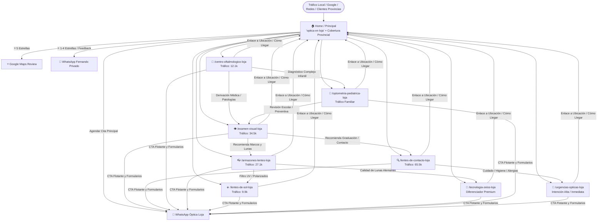

# 🗺️ Arquitectura Integral y Mapa de Conexiones — Óptica Loja

Este documento describe en detalle el **objetivo estratégico de cada página**, las **palabras clave que ataca**, su **audiencia objetivo**, y cómo se **interconectan** entre sí para maximizar el posicionamiento local y las conversiones directas a WhatsApp / Google Reviews.

---

## 🖼️ Mapa Gráfico Visual de la Arquitectura

> 💡 **Nota de visualización:** Si estás en VS Code / Cursor / IDE, puedes abrir el archivo gráfico directamente en tu navegador o previsualizador haciendo clic aquí: [Ver arquitectura-grafico.svg](file:///d:/Abel%20paginas/Optica%20Loja/optica-loja-web/public/arquitectura-grafico.svg)

---

## 1. Diagrama de Flujo (Mermaid)

---

## 2. Ficha Detallada: Objetivo de Cada Página

| # | Página / Ruta | Objetivo Estratégico | Clúster SEO / Tráfico | CTA Principal |
|---|---|---|---|---|
| **0** | **Home (`/`)** | **Centro de mando:** Presentación de autoridad (ZEISS Vision Expert), reputación activa (filtro de reseñas) y captura del paciente provincial (Zamora, Yantzaza, Catamayo, etc.). | *ópticas en loja, mejor óptica loja, optometrista loja* | Agendar Examen Visual / Filtro de Reseñas ⭐ |
| **1** | **`/examen-visual-loja`** | Captar al usuario que busca revisión preventiva o siente visión borrosa/fatiga. Destaca precisión digital computarizada sin costo con compra de lentes. | *examen de la vista loja, examen visual gratis loja, agudeza visual* (~34.5k) | Agendar Examen Completo |
| **2** | **`/lentes-de-contacto-loja`** | Atacar el clúster con mayor volumen. Captar tanto a jóvenes (lentes estéticos/color) como a adultos (lentes graduados tóricos/multifocales) con prueba de adaptación guiada. | *lentes de contacto loja, pupilentes loja, lentes tóricos* (~65.5k) | Agendar Prueba de Adaptación |
| **3** | **`/centro-oftalmologico-loja`** | Posicionar a la clínica como centro médico de referencia cuando el problema no es solo graduación (glaucoma, cataratas, pterigión, retina). | *oftalmólogo loja, centro oftalmológico loja, clínica de ojos* (~12.1k) | Consulta Oftalmológica |
| **4** | **`/armazones-lentes-loja`** | Atraer compradores de moda y comodidad óptica: catálogo de marcas, tipos de montura según rostro y tratamientos antireflejo Blue Defense. | *armazones loja, monturas de lentes, lunas antireflejo* (~27.1k) | Cotizar Armazón + Lunas |
| **5** | **`/lentes-de-sol-loja`** | Capturar demanda de sol y protección UV en la sierra/oriente. Posicionar gafas polarizadas de marca con o sin medida. | *gafas de sol loja, lentes polarizados loja, gafas originales* (~9.9k) | Ver Disponibilidad de Modelos |
| **6** | **`/tecnologia-zeiss-loja`** | **Página de máxima autoridad:** Explicar el estatus de *ZEISS Vision Expert* (centrado digital i.Terminal, lunas de precisión alemana). Justifica precios premium. | *lentes zeiss loja, zeiss vision expert ecuador, lunas progresivas zeiss* | Solicitar Asesoría ZEISS |
| **7** | **`/optometria-pediatrica-loja`** | Atraer a padres de familia preocupados por rendimiento escolar, estrabismo, ojo vago o control de miopía infantil progresiva. | *optometría infantil loja, lentes para niños loja, estrabismo niños* | Agendar Chequeo Infantil |
| **8** | **`/urgencias-opticas-loja`** | Atender búsquedas con alta urgencia de conversión (ojo rojo, cuerpo extraño, rotura de montura, dolor ocular agudo). | *urgencias oftalmológicas loja, ojo rojo tratamiento loja, lentes rotos hoy* | Atención de Urgencia Inmediata |

---

## 3. Estrategia de Enlazado Interno (Link Architecture)

1. **Top-Down (De Home a Servicios):**
   - El Home cuenta con accesos directos destacados y un grid modular a cada uno de los 8 servicios clave.
   - Cuenta con el bloque provincial enfocado en captar a pacientes de cantones y provincias vecinas.

2. **Enlaces Contextuales Entre Servicios (Cross-linking):**
   - Cada servicio cuenta al final con una sección de **"Servicios relacionados"** que mantiene al usuario navegando dentro del ecosistema sin abandonar el sitio.
   - De **Examen Visual** ➡️ Sugiere **Lentes de Contacto** y **Armazones**.
   - De **Centro Oftalmológico** ➡️ Sugiere **Urgencias Ópticas** y **Optometría Pediátrica**.
   - De **Armazones** ➡️ Sugiere **Tecnología ZEISS** y **Lentes de Sol**.

3. **Bottom-Up (Footer & Navbar Global):**
   - El pie de página contiene los enlaces indexables directos a las 8 páginas principales, optimizando el rastreo del bot de Google (Googlebot) y distribuyendo el PageRank de forma uniforme.
   - El botón flotante de WhatsApp siempre incluye un mensaje pre-cargado contextualizado a la página actual (ej. *"Hola, estoy interesado en agendar un examen de lentes de contacto..."*).

---

## 4. Próximos Pasos Recomendados

- [x] Arquitectura de 8 páginas aprobada y compilada.
- [x] Filtro de reputación ⭐ y cobertura provincial integrados en Home.
- [x] Clúster de Lentes de Contacto implementado.
- [ ] Validar con Fernando las credenciales finales de Google Business Profile para el enlace directo de 5 estrellas.
- [ ] Integración de fotos reales del local renovado.
- [ ] Despliegue en hosting / producción (Vercel / Cloudflare).
